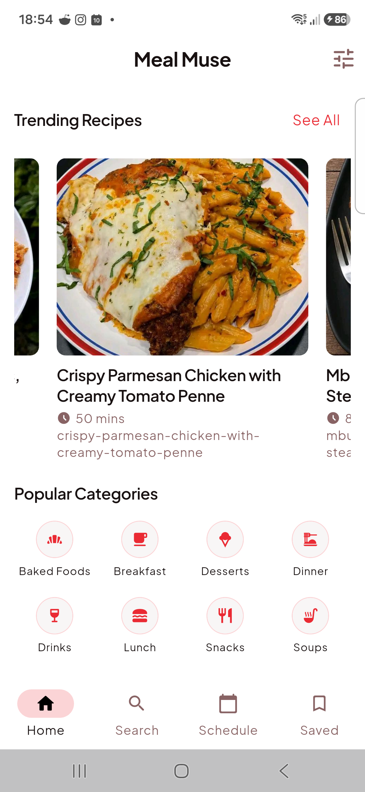
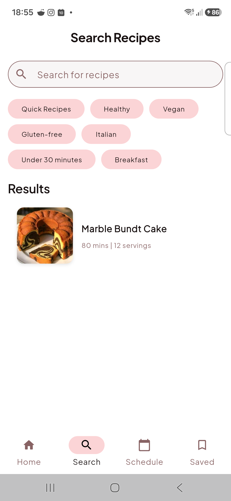
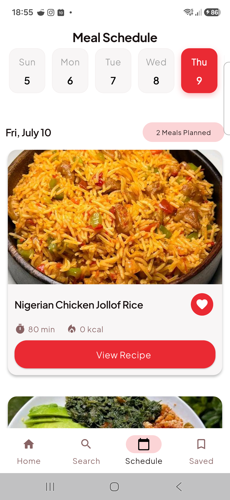
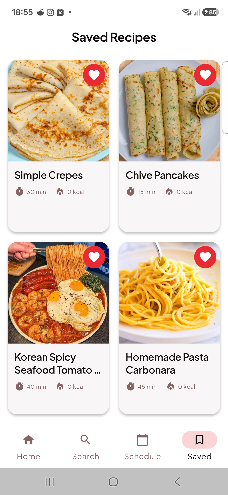

# Meal Muse

Meal Muse is a recipe generator that helps its users decide on the meals they will partake in, be it breakfast, lunch or supper. It is designed to fit the needs of Kenyans as the audience, with tailoring of cuisines that are locally available and easy to prepare. 

As development continues, more features will be showcased.

## How It Works

Meal Muse provides users with an intuitive interface to:
- **Discover Recipes:** Find locally relevant recipes tailored to Kenyan cuisines.
- **Meal Suggestions:** Get daily suggestions for breakfast, lunch, and supper.
- **Easy Preparation:** View step-by-step preparation instructions using locally available ingredients.

## Screenshots

  
  
  
  

## Download & Install

An Android build of the application is available. You can download and install it on your Android device using the link below:

- [📥 Download Meal Muse APK (Android)]((https://github.com/Pak-Man926/Meal_Muse/releases/tag/v1.0.0))

